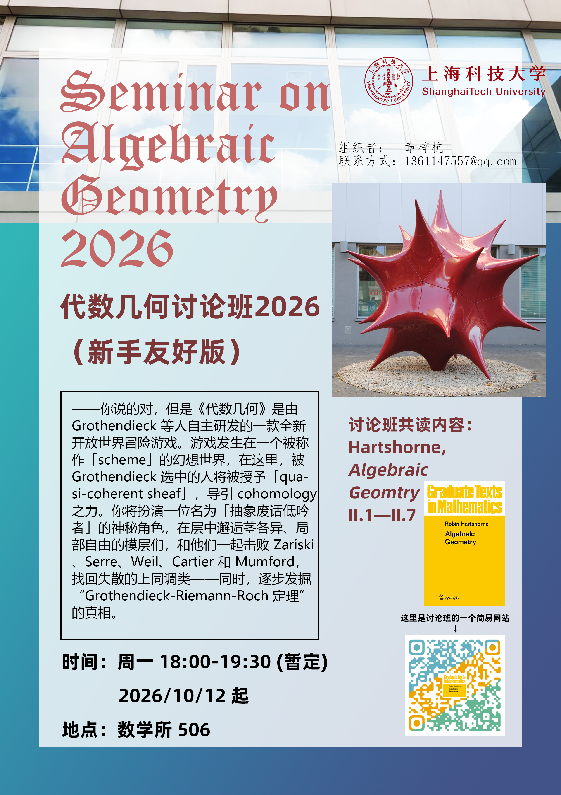

上海科技大学代数几何 2026 年秋季讨论班, 每周一 18:00-19:30 (暂定), 数学所 506, 从 10 月 12 日开始.

## Poster

这个海报上右边的这个代数曲面被叫做" 十二面体星"（Dodekaederstern）, 除去 20 个奇点以外均光滑, 出自网页 [https://www.dodekaederstern.cc/](https://www.dodekaederstern.cc/).

## Seminar Description

本讨论班以 Hartshorne《Algebraic Geometry》为主线，学习代数几何的基本概念。我们计划在一学期内共读 Chapter II.1 -- Chapter II.7，目标掌握概形的基本性质与工具。

Hartshorne 作为代数几何的“圣经”，又具有晦涩和习题繁杂的特点，因此我们鼓励同学们以该书为主线辅以其他材料进行学习，并欢迎在讨论班上分享不同的视角与观点。此外，由于 Hartshorne 的正文多引用习题，并且有很多重要的命题被写成习题，本讨论班鼓励同学们讲述一些重要的习题，欢迎一切关于习题和定理的讨论。

讨论班采用轮值主讲和课后讨论的形式，每周一次，每次时长 1.5 小时。鼓励主讲人在讨论班开始前发布整理好的笔记，供听众更好理解。

由于组织者们均为代数几何初学者，而 Hartshorne 是本新手不友好的书，因此我们希望讨论班能够通过共读做到新手友好。欢迎所有同学来听！如您愿意加入讨论班担任主讲，请联系我们！

## Seminar Information

| 项目 | 内容 |
|------|------|
| 时间 | 周一 18:00 -- 19:30 (暂定) |
| 地点 | 数学所 506 |
| 教材 | R. Hartshorne, *Algebraic Geometry*, GTM 52, Springer. |
| 范围 | Chapter II.1 -- Chapter II.7 |
| 对象 | 本科生/研究生, 欢迎所有人参加 |
| 预备知识 | 范畴论, 抽象代数, 交换代数 |

## Textbooks & References

- R. Hartshorne, [*Algebraic Geometry*](https://link.springer.com/book/10.1007/978-1-4757-3849-0).
- R. Vakil, [The Rising Sea: Foundations of Algebraic Geometry](https://math.stanford.edu/~vakil/216blog/FOAGjul2724public.pdf).
- D. Eisenbud and J. Harris, [*The Geometry of Schemes*](https://link.springer.com/book/10.1007/b97680).
- The Stacks project authors, [The Stacks project](https://stacks.math.columbia.edu/).

and so on.

## Tentative Schedule

Here is a note of the seminar: [Notes-AG-2026](/latex/Notes%20on%20Seminar%20AG%202026/NotesAG.pdf)

| Time | Topics | Hartshorne | Speaker | Notes |
|---|--------|------------|---------| --- |
| 2026/10/12 | Sheaves, stalks, local nature of sheaves  | II.1 | 章梓杭 | [Notes-AG-2026](/latex/Notes%20on%20Seminar%20AG%202026/NotesAG.pdf)1.1-1.3 |
| 2026/10/19 | Sheafification, $\mathsf{Sh}$, global section functor| II.1 | 章梓杭 |[Notes-AG-2026](/latex/Notes%20on%20Seminar%20AG%202026/NotesAG.pdf)1.4-1.7  |
| 2026/10/27 | Base sheaf, gluing sheaves, locally ringed spaces | II.2 | 章梓杭 | [Notes-AG-2026](/latex/Notes%20on%20Seminar%20AG%202026/NotesAG.pdf)1.8-2.3 |
| 2026/11/2 |  | II.2 | 章梓杭 | [Notes-AG-2026](/latex/Notes%20on%20Seminar%20AG%202026/NotesAG.pdf)  |
| 5 | Reduced, integral, noetherian, finite type, immersion | II.3 |  |   |
| 6 | Algebraic scheme, dimension, fibred product | II.3 |  |    |
| 7 | Separated and proper morphism, valuative criterion | II.4 |  |    |
| 8 | Projective morphisms | II.4 |  |    |
| 9 | Sheaves of modules | II.5 |  |    |
| 10 | Quasi-coherent sheaves | II.5 |  |    |
| 11 | Quasi-coherent sheaves on $\operatorname{Proj}S$ | II.5 |  |   |
| 12 | Weil divisors | II.6 |  |    |
| 13 | Cartier divisors | II.6 |  |    |
| 14 | Projective morphisms, ample invertible sheaves | II.7 |  |   |
| 15 | Linear system, relative $\mathbf{Proj}$ | II.7 |  |   |

下面是讨论班的 PDF 版大纲: [Syllabus AG2026.pdf](/latex/Syllabus%20on%20Seminar%20AG%202026/Syllabus%20AG2026.pdf)

## Slogan (数学原神)

你说的对，但是《代数几何》是由 Grothendieck 等人自主研发的一款全新开放世界冒险游戏。游戏发生在一个被称作「scheme」的幻想世界，在这里，被 Grothendieck 选中的人将被授予「quasi-coherent sheaf」，导引 cohomology 之力。你将扮演一位名为「抽象废话低吟者」的神秘角色，在层中邂逅茎各异、局部自由的模层们，和他们一起击败 Zariski、Serre、Weil、Cartier 和 Mumford，找回失散的上同调类——同时，逐步发掘“Grothendieck-Riemann-Roch 定理” 的真相.

> P.S. 这段是我参考 [作为纯数学讨论班的组织者，你对组织讨论班有什么建议？ - 樱花树下的数学喵的回答 - 知乎](https://www.zhihu.com/question/1985052586496254205/answer/1985109188670681731) 与 DeepSeek 共创的.

## Resources

我会在这里不定时地放上一些代数几何的相关资源.

- 袁新意, [学习代数几何的建议](http://faculty.bicmr.pku.edu.cn/~yxy/preprints/AGstudy(v2.2).pdf).
  袁老师关于代数几何初学的相关资料和学习路线的汇总.
- Herwig Hauser, [Gallery of Singular Algebraic Surfaces](https://homepage.univie.ac.at/herwig.hauser/gallery.html).
  代数几何也可以可视化!
- 到处逛, [代数几何简史](https://zhuanlan.zhihu.com/p/148865387).
  这是一篇非常好的导引文章, 能够通过历史的足迹看遍代数几何的各个概念的由来, 也能将读者引导至更深的地方.
- Thread478, [关于微分流形（？）其实是关于代数几何。](https://zhuanlan.zhihu.com/p/2011854180332110938). 这篇文章将代数几何里面层扮演的角色与层在微分几何中的角色相联系起来, 其中最为精彩的是, 对于光滑流形 $ M $ 的 $ \mathcal{O}_{M} $-模层, 全局截面函子 $ \Gamma $ 是正合的, 而我们这一正合性对于一般的层 (特别是概形上的 $\mathcal{O}_{X}$-模), 是不成立的. 正合性失效的原因就在于 Zariski topology 过于稀疏了.
- Secret Blogging Seminar, [Algebraic geometry without prime ideals](https://sbseminar.wordpress.com/2009/08/06/algebraic-geometry-without-prime-ideals/). 学过代数簇的人自然会发现, 根据 Hilbert's Nullstellensatz, 实际上代数簇完全可以用 Spm A 来描述, 即有限生成 k-代数上的极大理想. 而在概形中, Spec A 是取所有的素理想, 这就会比代数簇中多出了不少的点, 简单来说就是在闭点 (作为代数簇上的点, 极大理想对应的点) 之外多出了一些点, 比如仿射平面中的一条椭圆曲线本身就会成为一个点, 而这个点在这条椭圆曲线包含其上所有闭点所构成的余 1 维闭子概型中则是一个泛点 (generic point, 即单点集的闭包为整个空间的点).
  这篇 blog 就是在讨论如果用 Spm A 去构造概形会怎样, 进而引发一场关于概形应该如何定义的讨论, 其中最重要的就是 functor of points, 即可以完全用函子的语言去定义概形, 这种语言在模空间和代数群中非常重要且直观, 但反之这种语言显然对初学者极度不友好.
  推荐阅读最后 James Milne 的回答, 我非常赞同他的观点: 初学应该从代数簇入手提供几何直观 (就算是完全用概形语言叙述的 The Rising Sea 中其实也花了大篇幅去理解经典代数几何的几何直觉), 但在代数簇上就应该加入局部环化空间, 目的是将流形上的结构与代数簇的结构进行类比. 另一方面, 在度过初学期之后也应该积极地拥抱函子观, 毕竟这种更加抽象的等价定义往往意味着推广的空间, 更深的结构更加需要这些抽象的语言, 但抽象的语言也不应该埋没几何的直觉.
